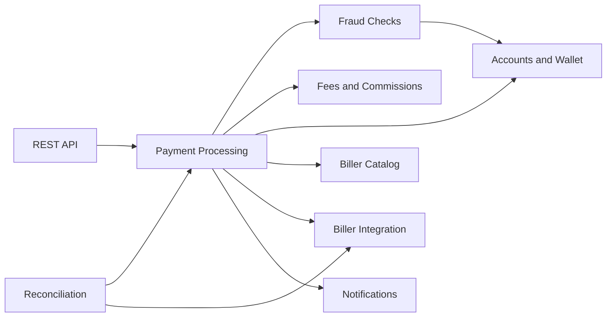

# PayLink Architecture Notes 

## 1. Architecture style

PayLink is a **layered modular monolith**: one deployable application, internally split into modules with clear boundaries. Each module is a package under `com.paylink.<module>` and contains four layers:

| Layer | Contents | May depend on |
|---|---|---|
| api | REST controllers, request/response DTOs | application |
| application | Services / use cases, the module's public interface | domain |
| domain | Entities, business rules, state machine | nothing outside the module |
| infrastructure | Repositories, database, external clients | domain |

Rules:
1. Modules talk to each other **only through the public interface** of the other module (an interface in its `application` layer), never through its repositories or tables.
2. Each table is **owned by exactly one module**. Only the owner writes to it.
3. Money logic lives in one place (Accounts & Wallet). No other module changes balances directly.
4. Biller protocol details (REST/JSON, SOAP-style XML, async callbacks, CSV) never leave Biller Integration.
5. Business numbers (limits, fees, timeouts, retries, promotions, commission) come from configuration, not constants.

Why a modular monolith: simpler to build, test and deploy in the project timeframe than microservices, while keeping boundaries that allow Notifications and Reconciliation to become event-driven in Phase 2.

## 2. Modules

### 2.1 Accounts & Wallet
- **Responsibility:** customers, agents, verification level, wallets, ledger, holds, top-ups, account blocking.
- **Owns tables:** `users`, `wallets`, `ledger_entries`, `wallet_holds`.
- **Public interface:** `registerCustomer`, `getBalance(walletId)` (available and held, computed from ledger), `topUp`, `holdFunds(walletId, paymentId, amount)`, `captureHold(paymentId)`, `releaseHold(paymentId)`, `postFeeIncome`, `postCommission`, `blockAccount` / `unblockAccount`.
- **Key rules:** balances are derived from ledger entries and never overwritten; holds are atomic and locked so concurrent payments cannot make a balance negative.
- **Does not know:** billers, fee rules, payment states.

### 2.2 Biller Catalog
- **Responsibility:** billers, services, required input fields, min/max amounts, active or disabled.
- **Owns tables:** `billers`, `biller_services`, `service_input_fields`.
- **Public interface:** `listActiveBillers`, `getService(serviceId)`, `getRequiredFields(serviceId)`, `isServiceActive(serviceId)`.
- **Does not know:** how to contact a biller.

### 2.3 Payment Processing
- **Responsibility:** payment life cycle (state machine), idempotency, orchestration of the payment steps, payment history for support, completed-payment refund requests.
- **Owns tables:** `payments`, `payment_events`, `refund_requests`.
- **Public interface:** `createPayment(request, idempotencyKey)`, `getPayment(reference)`, `getPaymentHistory(reference)`, `handleBillerResult(paymentId, result)`, `requestRefund`.
- **Orchestration order:** limits and fraud check, quote fee, hold funds, send to biller, apply result (capture or release), request notifications.
- **Key rules:** only the transitions allowed in the requirements (Initiated, FundsHeld, SentToBiller, Completed, Failed, Unknown, Rejected, Refunded); Unknown is never refunded automatically; the fee is locked at initiation.
- **Depends on:** Fraud, Fees, Accounts & Wallet, Biller Catalog, Biller Integration, Notifications (interfaces only).

### 2.4 Biller Integration
- **Responsibility:** one adapter per biller that hides its protocol; timeout, status re-query, and asynchronous callbacks.
- **Owns tables:** `biller_callbacks`.
- **Public interface:** `inquire(service, inputs)`, `pay(request)`, `queryStatus(billerReference)`, `handleCallback(payload)`. All return a **normalized internal result** (SUCCESS, REFUSED, PENDING, TIMEOUT).
- **Key rules:** adapters for ElectroCo, AquaCo, TopUpNet (NetCo optional); a factory selects the adapter from configuration; duplicate callbacks are ignored and logged. The ElectroCo v2 change (field names, piasters, signing) is absorbed inside its adapter only.
- **Does not know:** wallets, fees, payment rules.

### 2.5 Fees & Commissions
- **Responsibility:** fee calculation (fixed, percentage, tiered, promotion) and agent commission.
- **Owns tables:** `fee_rules`, `promotions`, `agent_commissions`.
- **Public interface:** `calculateFee(service, amount, date)`, `calculateCommission(fee)`, `recordCommission(paymentId)`.
- **Does not know:** payment states or billers' protocols.

### 2.6 Notifications
- **Responsibility:** SMS, push and email messages, templates, retry (3 times) then undelivered.
- **Owns tables:** `notifications`.
- **Public interface:** `notify(userId, paymentId, templateCode, channels)`.
- **Key rule:** a notification failure never changes the payment result.

### 2.7 Additional areas
- **Fraud Checks:** a chain of rules (blocked account, single-payment limit, daily limit, velocity). Interface: `check(paymentRequest)` returns pass or a clear rejection reason. Owns no table; reads payment counts through Payment Processing and blocks accounts through Accounts & Wallet.
- **Reconciliation:** compares settlement files with payments and flags differences (never silently rewrites a payment). Owns `settlement_files`, `reconciliation_items`.
- **Shared components (cross-cutting):** `audit` (owns `audit_logs`; records who, when, why for money movements and admin actions) and `configuration` (owns `system_settings`).

## 3. Dependency overview

Direction rule: arrows point from caller to the module being called. Accounts & Wallet, Biller Catalog and Fees do not call Payment Processing.

## 4. How the quality requirements are supported

| Requirement | Architectural support |
|---|---|
| Zero double charges | Idempotency key unique per customer in `payments` |
| No negative balance | Atomic hold with wallet lock inside Accounts & Wallet |
| Modifiability (new biller) | New adapter plus configuration only; Factory selects adapter |
| Resilience | Each biller adapter isolated; one biller failing does not block others |
| Auditability | Every ledger entry and admin action goes through the audit component |
| Testability | Each module has its own tests; domain layer has no framework dependency |

## 5. Assumptions for Phase 2

1. Modules communicate with direct method calls first; Notifications and Reconciliation then move to events through RabbitMQ (with an ADR comparing options).
2. Database schema is created through version-controlled migrations (for example Flyway), matching the ER diagram.
3. Design patterns planned: State (payment), Strategy (fees), Chain of Responsibility (fraud), Adapter and Factory (billers), Observer (notifications).
4. Pending team or TA decisions are listed in the requirements assumptions (A-03, A-04, A-08, A-17 to A-21, A-24).
